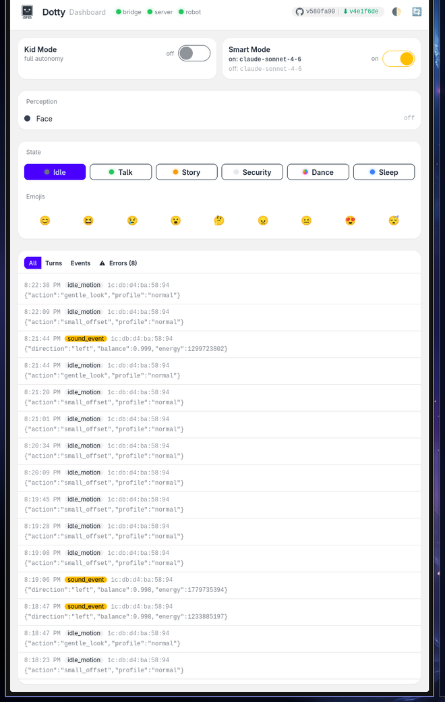
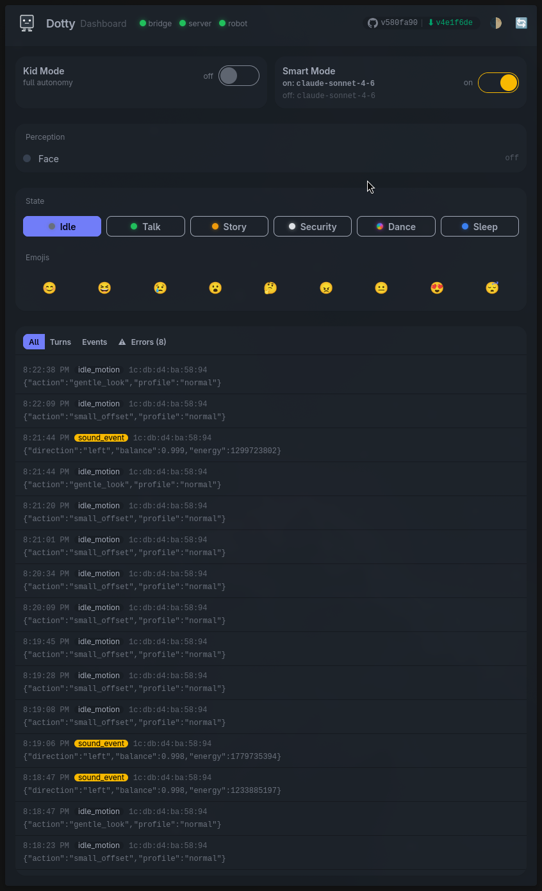

  

# Dotty

**Your self-hosted [StackChan](https://github.com/m5stack/StackChan) robot assistant: kid-minded by default, hackable by design, private by architecture.**

> **Status:** a hobby project with one maintainer, built with heavy AI assistance ([AI_TRANSPARENCY.md](./AI_TRANSPARENCY.md)). It runs end to end on the maintainer's own robot and server, but nobody has verified it on anyone else's hardware yet, and config can still change between releases. Known problems are in the [issue tracker](https://github.com/BrettKinny/dotty-stackchan/issues); bug reports and "this didn't work for me" issues are welcome.

Dotty is a fully self-hosted voice stack for the M5Stack StackChan desktop robot. Open-source firmware runs on the robot, [xiaozhi-esp32-server](https://github.com/xinnan-tech/xiaozhi-esp32-server) handles voice I/O, and a local **pi** coding agent is the brain. ASR, TTS and session state all run on your own hardware. The LLM is pluggable. The shipped default runs a small, fast model for plain conversation and hands hard questions to a more capable one, with [llama-swap](./docs/cookbook/llama-swap-concurrent-models.md) as the recommended local backend. [Ollama](./docs/cookbook/run-fully-local.md) is the simpler single-binary option, or you can point it at OpenRouter or any OpenAI-compatible API if you'd rather use the cloud.

Out of the box, Dotty runs in **Kid Mode**. The persona and the Kid Mode rules in pi's system prompt steer replies toward age-appropriate topics, and a blocked-words filter replaces a matching LLM reply before it is spoken. The filter is a backstop that can be bypassed, not a safety guarantee or a substitute for supervision. Turn Kid Mode off for a general-purpose assistant.

## Why I built this

I didn't want a camera and microphone running in my house unless I could host the whole stack myself and understand how every part of it works. Off-the-shelf voice assistants fail on both counts. Your audio leaves the house, the model is a black box, and you're stuck trusting a vendor's privacy policy for as long as you use it.

Dotty is my attempt at one that passes. Every component runs on hardware I own, and every piece is documented and can be swapped out. The only thing that can leave my network is an LLM call I've chosen to send out, and a config change swaps even that for a local model. It's also meant to be fun: a friendly desktop robot for the kids, and a hobby project I can keep building on.

## AI transparency

**Yes, Dotty is built with AI assistance, and I'm open about it.** Coding agents help me write the code, draft the docs and triage issues. That's a deliberate choice, not something I'm hiding. The rule: **anything an AI agent authors is acknowledged as such** (model-named `Co-Authored-By:` trailers, AI-assisted PR notes, marked AI-drafted docs), with a human reviewing and accountable for everything that lands.

Full policy: [`AI_TRANSPARENCY.md`](./AI_TRANSPARENCY.md).

## Features

- **Kid Mode (on by default):** age-appropriate replies through the persona and the Kid Mode rules in pi's system prompt, backed by a blocked-words filter on every LLM voice reply ([#157](https://github.com/BrettKinny/dotty-stackchan/issues/157)). If the filter itself fails, the reply is replaced rather than spoken. Speech the server pushes directly (the proactive greeter, admin `say`) does not pass through the filter. It can still be bypassed and is not a substitute for supervision. See [`docs/kid-mode.md`](./docs/kid-mode.md).
- **Local ASR:** FunASR SenseVoiceSmall by default, with no cloud transcription. WhisperLocal is picked automatically on GPU hosts and handles kids' voices better; SenseVoiceOnnx is a lighter option for low-RAM hosts.
- **Local or cloud TTS:** Piper (offline) or EdgeTTS (cloud), switched with a config change.
- **Streaming replies:** the voice provider streams the model's reply into TTS sentence by sentence, so Dotty starts talking before the whole answer is written.
- **Face expressions:** every reply starts with an emoji that the firmware turns into a face (smile, laugh, sad, surprise, thinking, angry, love, sleepy, neutral). The server makes sure each reply leads with exactly one face the firmware supports.
- **Voice tools:** mid-conversation, the pi agent can remember things and people and look them up later, pass a hard question to a bigger model, take a photo and describe it, and play a song.
- **States, toggles and LEDs:** six states (`idle / talk / story_time / security / sleep / dance`) plus two independent toggles (`kid_mode`, `smart_mode`), all owned by the firmware StateManager and shown on the 12-pixel LED ring. See [`docs/modes.md`](./docs/modes.md).
- **Privacy sleep:** in `sleep`, the firmware turns off face detection, voice processing and wake-word detection. Only a head touch or an explicit dashboard state change wakes it, not a face or a voice. This stops the normal camera and microphone paths; it is not a hardware power cut.
- **Vision:** the robot's camera can take a photo for a vision model to describe. The default is a cloud API (OpenRouter); to keep frames on your LAN, see [Keeping vision and audio on the LAN](./docs/brain.md#keeping-vision-and-audio-on-the-lan).
- **Calendar context:** optional calendar integration adds upcoming events to the conversation.
- **Hackable:** every seam can be swapped: LLM, TTS, ASR, agent framework. Fork it, rip out what you don't want, wire in your own.

## States, Toggles & LEDs

Behaviour is **one of six states** (`idle / talk / story_time / security / sleep / dance`) plus two independent toggles (`kid_mode`, `smart_mode`), all owned by the firmware StateManager. Voice phrases, camera events and dashboard controls all go through it. Bench checks are tracked in [#38](https://github.com/BrettKinny/dotty-stackchan/issues/38).

> Note: `firmware/` is a release pointer, not the active development checkout. The pinned build (`969c2b2`) includes the StateManager, but later fixes may only be on the active fork, so check your actual revision. See "Firmware iteration" in [`CLAUDE.md`](./CLAUDE.md) and the submodule note in [`docs/modes.md`](./docs/modes.md).

The 12-pixel LED ring shows the current state at a glance. **Left ring pixels 0-5 are the state arc.** All six show the state colour, matching the dashboard's state buttons:

|   | State |
|---|---|
| ⚫ | `idle`: ambient awareness; ring off. Default. |
| 🟢 | `talk`: in a conversation. |
| 🟠 | `story_time`: a long-running interactive story. |
| ⚪ | `security`: watching the room (1 Hz white flash). |
| 🔵 | `sleep`: privacy sleep (see Features). Wake by head touch or a dashboard state change. |
| 🟣 | `dance`: rainbow sweep and choreography. |

On the right ring, **pixel 6 (top) is the face light**: yellow when a face is detected, green once it has been recognised. **Pixels 8 and 9 are the toggle lights** for kid_mode (salmon pink) and smart_mode (orange), and **pixel 11 (bottom) lights red while it's your turn to speak**. Pixels 7 and 10 are reserved and stay off. Seeing a face moves Dotty from `idle` to `talk`; recognising who it is runs alongside and feeds the conversation.

> Older firmware from before the StateManager (the historical `35f701a` pin) uses pixels 6 and 11 differently: 6 is a green microphone light and 11 a red camera light. The pinned and current firmware use the layout above.

Full state list, colour palette, transition diagram and how each state is implemented: [`docs/modes.md`](./docs/modes.md).

## Web dashboard (locally hosted)

The dashboard is served at `http://<XIAOZHI_HOST>:8081/ui`. It shows host status, the Kid Mode and Smart Mode toggles, a state switcher, a perception card (face and identity), emoji presets, and a live log of turns, perception events and errors. Light and dark themes follow the system setting. It runs as a small FastAPI service (`bridge.py`) on your own hardware, and no external service sees your data.

  
  &nbsp;
  

## Reference deployment

- **Hardware:** M5Stack StackChan (CoreS3 + servo kit), running firmware built from the [`BrettKinny/StackChan`](https://github.com/BrettKinny/StackChan) fork of `m5stack/StackChan`.
- **Brain:** a **pi** coding agent in the `dotty-pi` container. It runs `qwen3.5:4b` on local [llama-swap](./docs/cookbook/llama-swap-concurrent-models.md) for the conversation and passes hard questions to `qwen3.6:27b-think` (also on llama-swap) through its `think_hard` tool. xiaozhi-server's `PiVoiceLLM` provider hands each voice turn to the agent. See [`docs/brain.md`](./docs/brain.md).
- **Voice I/O:** xiaozhi-esp32-server in Docker (any Linux Docker host).

## What runs where

| Component | Host | Notes |
|---|---|---|
| StackChan (device) | ESP32-S3 on the desk | Firmware from the `BrettKinny/StackChan` fork (see `SETUP.md`) |
| xiaozhi-esp32-server | server (`<XIAOZHI_HOST>`) | Docker: voice I/O, ports 8000 and 8003 |
| dotty-pi | server (`<XIAOZHI_HOST>`) | Docker: the pi agent, Dotty's brain |
| dotty-behaviour | server (`<XIAOZHI_HOST>`) | Docker, FastAPI: perception, ambient behaviour, vision, greeter; port 8090 |
| dashboard service | server (`<XIAOZHI_HOST>`) | Docker, FastAPI: the admin dashboard (`bridge.py`); port 8081 |
| Admin workstation | any LAN box | Development and `ssh` only |

## Get it running

The stack is the robot plus four server-side pieces: xiaozhi-server (voice I/O), `dotty-pi` (the pi agent brain), `dotty-behaviour` (perception, ambient behaviour and the greeter) and the admin dashboard. All four run as Docker containers on one host, next to a local model backend ([llama-swap](./docs/cookbook/llama-swap-concurrent-models.md), or [Ollama](./docs/cookbook/run-fully-local.md) for the simpler single-binary option).

Then:

- [`docs/quickstart.md`](./docs/quickstart.md): the 15-minute happy path from flashing to a first conversation, with the placeholder table, deployment layout, endpoints, reboot survival and common ops snippets.
- [`docs/troubleshooting.md`](./docs/troubleshooting.md): look up a symptom to find common (and obscure) failures.

## Support

Questions, bugs, or "this didn't work for me": [open a GitHub issue](https://github.com/BrettKinny/dotty-stackchan/issues). That's the best way to reach me. Occasional updates also go up on [r/stackchan](https://www.reddit.com/r/stackchan/).

## Deeper reference

For what the stack *is* underneath (hardware specs, protocol docs, model facts, and features we aren't using), see [`docs/`](./docs/README.md):

- [docs/architecture.md](./docs/architecture.md): end-to-end data flow, topology, deployment files, admin surface, perception bus, threat model.
- [docs/hardware.md](./docs/hardware.md): the M5Stack StackChan body, firmware lineage and on-device MCP tool catalogue.
- [docs/voice-pipeline.md](./docs/voice-pipeline.md): xiaozhi-esp32-server internals, FunASR/SenseVoice, VAD, TTS.
- [docs/brain.md](./docs/brain.md): the model matrix, the pi agent runtime, and how voice turns reach it.
- [docs/protocols.md](./docs/protocols.md): Xiaozhi WS framing, MCP over WS, pi RPC, the dashboard HTTP API, the emotion channel.
- [docs/modes.md](./docs/modes.md): states, the LED contract and the transition diagram, with what has shipped and what is planned.
- [docs/latent-capabilities.md](./docs/latent-capabilities.md): features upstream supports that we aren't using yet.
- [docs/references.md](./docs/references.md): upstream URLs, model cards, licences.

## References

- xiaozhi-esp32-server: https://github.com/xinnan-tech/xiaozhi-esp32-server
- xiaozhi-esp32 firmware (upstream): https://github.com/78/xiaozhi-esp32
- StackChan (hardware + open firmware): https://github.com/m5stack/StackChan
- Emotion protocol: https://xiaozhi.dev/en/docs/development/emotion/
